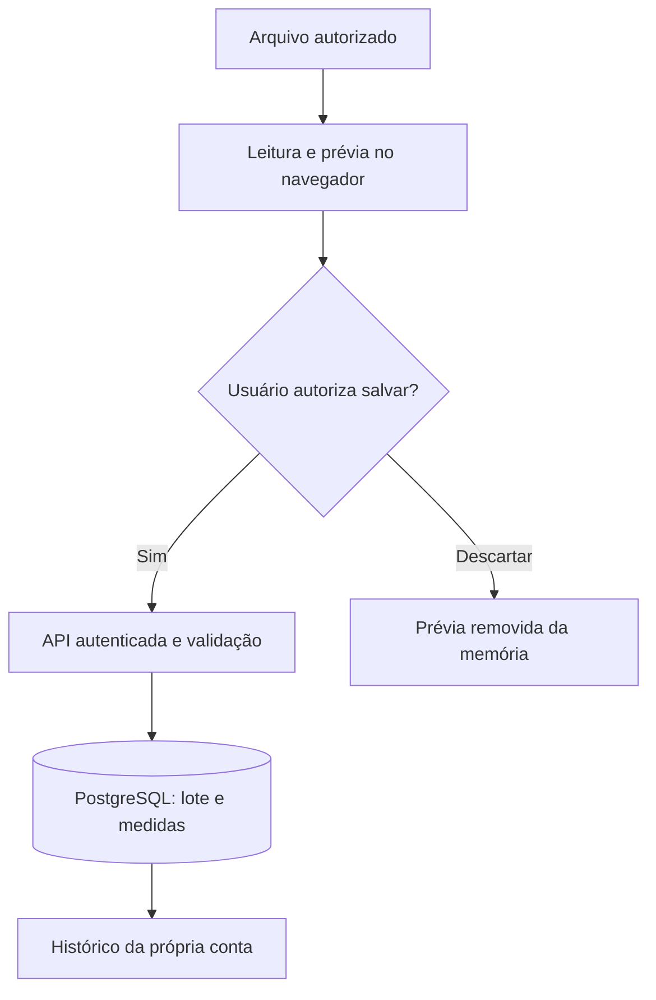

# Relatório: AROW e relógios no Saúde em Órbita

Data: 14 de novembro de 2026.

## O que foi implementado

O projeto ganhou a página **Mission & device integrations**, em `#/integrations`, com entrada pela Home e pela área de dados médicos. Ela reúne o acesso oficial ao AROW, os caminhos para os dispositivos solicitados e uma importação de medidas com prévia, confirmação e histórico separado por usuário no PostgreSQL.

| Integração | O que você pode usar agora | O que ainda exige desenvolvimento/acesso externo |
| --- | --- | --- |
| NASA AROW | Abrir a página oficial a partir do projeto | Exibir posição e telemetria diretamente no painel com uma fonte validada |
| Apple Watch / Apple Health | Importar XML compatível do app Saúde ou dados no modelo JSON/CSV | Sincronização automática por aplicativo iOS com HealthKit |
| Samsung Galaxy Watch | Importar dados convertidos para o modelo JSON/CSV Health7 | Aplicativo Android com Health Connect ou SDK da Samsung e permissões |
| Garmin | Importar dados convertidos para o modelo JSON/CSV Health7 | Integração autorizada com Garmin Connect e configuração de credenciais |
| ActLumus, da Condor, ligado à USP | Importar temperatura da pele e canais específicos de luz no modelo Health7 | Mapear uma exportação real do ActStudio e validar com fabricante/equipe de pesquisa |

Portanto, o que está pronto é **acesso ao recurso AROW e importação por arquivo**. A página não anuncia conexão automática com um relógio. Não foram criadas contas de fabricantes, aplicativos para celular ou acesso à telemetria médica da NASA.

## O dispositivo da USP

O dispositivo mencionado é o **ActLumus**, um actígrafo produzido pela Condor Instruments e relacionado a pesquisadores da USP. A [Agência USP de Inovação relata seu uso na Artemis II](https://auspin.usp.br/tecnologia-brasileira-e-lancada-no-espaco-com-os-tripulantes-da-artemis/). Ele atende pesquisas de ritmos biológicos e exposição luminosa; não deve ser tratado como um relógio que fornece automaticamente todos os sinais vitais.

O [manual do fabricante](https://condorinst.com/wp-content/uploads/2025/05/Manual_ActTrust_2_1_0_EN.pdf) descreve sensores, canais de luz e exportações pelo ActStudio. O código preserva a diferença entre luz fotópica e melanópica e entre temperatura da pele e temperatura corporal. Não transforma movimento em horas dormidas nem luz em dose de radiação.

## Como os dados entram no projeto

O fluxo funciona assim:

O arquivo original não é enviado. O servidor recebe somente as amostras normalizadas. Os modelos para download contêm dados fictícios identificados como `example`; dados reais importados recebem `unverified`, porque a origem declarada no arquivo não foi autenticada pelo fabricante.

Foram criadas duas tabelas: `wearable_imports` registra cada lote e `wearable_samples` guarda as medidas. O banco mantém origem, dispositivo declarado, unidade, horário e qualidade. Repetir o envio não duplica o mesmo registro. Um conflito de valores para a mesma observação cancela o lote inteiro, evitando sobrescrever silenciosamente o histórico.

As consultas usam a conta autenticada. Uma conta não escolhe o dono pelo arquivo nem consulta os dados de outra. Pedidos iniciados na tela são cancelados ao sair dela, e cada requisição também informa a conta esperada.

## Por que não coloquei tudo diretamente no mapa corporal

O painel atual trabalha com check-ups simulados e avaliações demonstrativas. Medidas de relógios podem ser obtidas durante exercício, em repouso, durante o sono ou por sensores com significados diferentes. Misturar tudo poderia produzir comparações erradas.

Nesta versão, os registros importados aparecem em seu próprio histórico e **não alteram alertas, referências pessoais, mapa corporal ou simulações**. Eles ficam disponíveis para uma próxima camada de avaliação, que precisará selecionar contexto, fonte, qualidade e regras adequadas. O material NTRS já documentado continua como referência de arquitetura e metodologia; ele não valida automaticamente um dispositivo ou uma regra do aplicativo.

## Como testar na interface

1. Entrar e abrir **Mission & device integrations** na Home.
2. Escolher Apple, Samsung, Garmin ou ActLumus.
3. Baixar um modelo JSON ou CSV e importá-lo sem alterações para conferir o fluxo com dados fictícios.
4. Conferir a prévia, marcar a autorização e salvar.
5. Verificar o resultado e o histórico. Importar o mesmo exemplo novamente deve informar duplicata.

Para Apple Health, é possível [exportar os dados do app Saúde em XML](https://support.apple.com/en-gb/guide/iphone/iph5ede58c3d/ios). A importação aceita os tipos documentados: frequência cardíaca, frequência em repouso, saturação, frequência respiratória, massa corporal e temperatura do punho durante o sono. Categorias de sono e outros tipos são contados como não suportados; não se soma automaticamente tempo na cama ou estágios sobrepostos.

O limite é 10 MiB e 500 amostras suportadas por arquivo, com 256 KiB para o conteúdo normalizado enviado. Exportações grandes precisam ser divididas ou convertidas. O histórico exibe as 100 medidas mais recentes e avisa se existem outras. Não há fila offline, exclusão ou exportação desse histórico pela interface nesta entrega.

## O que falta para sincronizar sem arquivos

Para Apple, será necessário um aplicativo iOS autorizado pelo usuário a ler os tipos de dados pelo [HealthKit](https://developer.apple.com/documentation/healthkit). Para Samsung, será necessário um aplicativo Android usando [Health Connect](https://developer.android.com/health-and-fitness/health-connect/read-data) ou o [Samsung Health Data SDK](https://developer.samsung.com/health/data/overview.html), conforme os requisitos da aplicação. O site sozinho não lê esses repositórios do celular.

Para Garmin, precisamos escolher a modalidade de acesso e configurar a integração do [Garmin Connect Developer Program](https://developer.garmin.com/gc-developer-program/overview/), que apresenta caminhos Personal e Business. Para ActLumus, o próximo passo é obter uma exportação autorizada e validar nomes de colunas, unidades, fuso e canais do ActStudio. Depois disso pode ser escrito um conversor específico, sem tentar adivinhar o formato.

O [AROW oficial](https://www.nasa.gov/missions/artemis/artemis-2/track-nasas-artemis-ii-mission-in-real-time/) oferece acompanhamento e recursos de trajetória. O projeto abre essa fonte oficial e não exibe números de posição inventados nem presume que exista uma missão ativa. Trazer telemetria para dentro do painel exige uma etapa própria de escolha da fonte, validação, atualização e indicação de dados desatualizados.

## Instalação e validação

A mudança é aditiva, pela migração `004_wearables.sql`. No servidor que executa a aplicação, atualizar o código da branch correta, executar as migrações com a configuração existente e reiniciar/recompilar os serviços conforme o modo de execução. Não é necessário recriar contas ou substituir o banco. Enviar código ao GitHub não atualiza sozinho o servidor da rede local.

Passaram **33 testes do backend**, **51 testes do frontend** e **o fluxo específico de integração no navegador**, que verifica as quatro origens, consentimento, duplicatas, XML, persistência e isolamento entre contas. Também foram conferidas as telas de desktop e celular. As compilações passaram. O lint terminou sem erros, com um aviso já existente no roteiro preventivo. A suíte antiga de navegador não foi integralmente revalidada após as alterações mais recentes da `main`.

As instruções e os detalhes da validação estão na [documentação técnica](../docs/integrations.md). Os testes usam dados fictícios, PostgreSQL isolado e navegador local; ainda não foi feita validação com relógios físicos nem com credenciais dos fabricantes.

O código está preparado para receber dados de fontes diferentes com rastreabilidade. A próxima etapa funcional é escolher um primeiro dispositivo real e validar sua exportação ou construir seu conector automático, aproveitando o contrato e o armazenamento já disponíveis.
