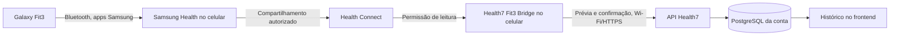

# Bluetooth e Galaxy Fit3 — 15/11/2026

## O caminho para o Fit3

O Galaxy Fit3 sincroniza com o celular pelo ecossistema Samsung. A [ficha da Samsung](https://www.samsung.com/uk/business/watches/galaxy-fit/galaxy-fit3-grey-bluetooth-sm-r390nzaaeub/) identifica sua plataforma como FreeRTOS; não é Wear OS. O APK desta entrega deve ser instalado **no celular**, não na pulseira.



A [Samsung documenta a sincronização com Health Connect](https://developer.samsung.com/health/health-connect-faq.html). A disponibilidade depende das permissões, dos aplicativos e do que foi efetivamente sincronizado. Esse caminho não representa pareamento direto do Fit3 pelo navegador nem atualização instantânea garantida.

## Primeiro teste

1. Abrir `#/integrations` e pressionar **Connect Samsung Galaxy Fit3 via phone**.
2. No celular, parear o Fit3 pelo Galaxy Wearable e conferir uma medida no Samsung Health.
3. No Samsung Health, permitir o compartilhamento de frequência cardíaca com o Health Connect. Consultar o [guia da Samsung](https://developer.samsung.com/health/blog/en/accessing-samsung-health-data-through-health-connect).
4. Em um **celular Android 14 ou superior**, instalar [Health7 Fit3 Bridge](../frontend/public/downloads/health7-fit3-bridge-debug.apk). O SHA-256 está no arquivo `.sha256` ao lado do APK.
5. Conceder ao aplicativo a leitura de frequência cardíaca no Health Connect.
6. Informar o endereço da **API** Health7 e entrar na própria conta. No teste local, usar `http://IP-DO-COMPUTADOR:3001`. `localhost` no celular aponta para o próprio celular.
7. Escolher 1, 6 ou 24 horas e tocar em **Read Samsung Health preview**.
8. Conferir a prévia, autorizar e tocar em **Send preview / retry remaining batches**.
9. No site, tocar em **Refresh imported history**. A origem aparece como **Android phone · Samsung Health / Health Connect**.

O APK é um protótipo de teste, não uma publicação na Play Store nem uma integração certificada. Foi compilado e sua assinatura foi verificada. Permissões, leitura e envio ainda precisam ser testados no seu celular e Fit3 físicos. Android 13 e anteriores exigem outra implementação, com a biblioteca Jetpack para o Health Connect distribuído como aplicativo; este APK usa a API nativa do Android 14+.

## Acesso pela rede

Computador e celular precisam comunicar-se pela rede. A API deve escutar em uma interface acessível (`HOST=0.0.0.0` no teste local), e a porta 3001 precisa estar permitida na rede privada pelo firewall. Obter o endereço Wi-Fi do computador com `ipconfig`. O banco pode continuar restrito a `127.0.0.1`; o celular acessa somente a API.

Usar **HTTPS** quando publicado. O protótipo também aceita HTTP para endereços privados durante desenvolvimento. Ele recusa redirecionamentos e mantém a verificação normal de certificados HTTPS.

## Aplicativo de celular

Código: `wearables/samsung-health-connect`.

- Lê somente `HeartRateRecord`, filtrado pela origem `com.sec.android.app.shealth` e pela janela escolhida.
- Mantém horários e unidade `bpm`. Usa o modelo dos metadados; quando ausente, identifica `Samsung Health | device unknown`. Não presume que todos os registros sejam do Fit3.
- Pagina a leitura, aceita até 5000 amostras por prévia e envia lotes de até 500. Acima desse limite, pede uma janela menor antes de enviar.
- Leitura, login e envio dependem de ações do usuário. Não há sincronização em segundo plano.
- Senha e cookie ficam em memória, sem gravação em preferências ou logs. A senha é removida do campo após entrar.
- Em falha de envio, preserva o conteúdo e o `clientId` do lote para repetir sem duplicar. Lotes já confirmados não são reenviados durante aquela tentativa.

Contrato: `source: samsung`, `format: samsung-health-connect-v1`, `quality: unverified`, somente medidas pontuais de `heartRate`. O servidor mantém `transport: android-health-connect`, `protocol: samsung-health-heart-rate`, `verification: user-declared` e `assessment: not-evaluated`. O cliente declara a origem; isso não certifica fisicamente o aparelho.

A identidade das observações do Health Connect inclui o transporte para evitar conflito com importações por arquivo; não há deduplicação cruzada entre esses caminhos. Dados ficam separados dos check-ups simulados e não alteram alertas clínicos.

Para compilar novamente, instalar JDK, Android SDK platform 36 e build-tools 36.0.0:

```powershell
powershell -ExecutionPolicy Bypass -File .\wearables\samsung-health-connect\build.ps1 -SdkRoot CAMINHO-DO-ANDROID-SDK -PublishToFrontend
```

O script compila Java, gera DEX/APK, assina e verifica com `apksigner`. Intermediários e chave privada de depuração ficam em `build`, ignorado pelo Git. O APK e SHA-256 são copiados para os downloads do frontend. A chave usa as credenciais públicas convencionais de depuração Android; não serve para distribuição de produção.

## Bluetooth direto para sensores compatíveis

O cartão **Connect a Bluetooth heart-rate sensor** contém **Connect Bluetooth** e **Disconnect Bluetooth**. Recebe notificações do serviço BLE **Heart Rate** (`0x180D`), característica **Heart Rate Measurement** (`0x2A37`). Só dispositivos que anunciam esse serviço aparecem. Não se presume que o Fit3 ofereça esse transmissor; para ele usar a ponte acima.

O navegador precisa oferecer Web Bluetooth em HTTPS ou `localhost`. HTTP por IP de rede não atende a essa exigência. A seleção começa somente após o clique; a permissão pertence ao navegador. Ver [Chrome Developers](https://developer.chrome.com/docs/capabilities/bluetooth).

O decodificador segue o [Heart Rate Service da Bluetooth SIG](https://www.bluetooth.com/wp-content/uploads/Files/Specification/HTML/HRS_v1.0/out/en/index-en.html): UINT8/UINT16, contato do sensor, energia e intervalos RR opcionais. A faixa 1–350 bpm é um limite do contrato, não uma faixa de normalidade. Pacote inválido, ausência de contato ou leitura com mais de 15 segundos impedem salvar a medida atual.

Notificações ficam na aba até o usuário autorizar e pressionar **Save current Bluetooth reading**. A medida é congelada para repetição idempotente se a confirmação falhar. Sair da página ou trocar de conta desconecta e elimina dados não salvos. O horário é o recebimento no computador: o serviço não fornece um horário absoluto da medição.

Contrato: `source: bluetooth`, `format: bluetooth-hrs-v1`, `quality: unverified`, `metric: heartRate`. A migração aditiva `005_bluetooth_wearables.sql` permite a origem genérica. O servidor registra `transport: bluetooth-le` e `protocol: heart-rate-service`, sem inferir fabricante.

## Histórico antigo e validação

Foi adicionado **Load older measurements**, além dos primeiros 100 registros. A API usa cursor validado sobre `(at,id)`, páginas de até 100 e filtro da conta autenticada. Atualizar a lista volta aos registros mais recentes; novas inserções aparecem após essa atualização.

Testes de navegador usam um GATT simulado para verificar estados, autorização, leitura congelada em repetição, expiração, desconexão e contas distintas. A API usa PostgreSQL temporário UTF-8. O cenário Fit3 confere download do APK e apresentação de uma carga de teste. Isso não substitui um teste físico com a pulseira e o celular.

Referências Android: [HealthConnectManager](https://developer.android.com/reference/android/health/connect/HealthConnectManager), [permissões](https://developer.android.com/health-and-fitness/health-connect/get-started), [leitura e paginação](https://developer.android.com/health-and-fitness/health-connect/read-data).

### Resultados em 15/11/2026

- Backend: 41 testes passaram, incluindo os contratos Bluetooth/Health Connect e a paginação, com banco UTF-8 isolado.
- Frontend: 94 testes passaram, incluindo o decodificador e o ciclo de conexão BLE.
- Navegador: 12 cenários distintos passaram — login/avatar/offline (5), Bluetooth/Fit3/histórico (4), importação (1), dados médicos (1) e procedência nas estatísticas (1).
- Compilações do backend, frontend e APK Android passaram. Assinatura Android verificada com `apksigner`.
- Lint sem erros; aviso preexistente em `frontend/src/lib/roadmap.ts` sobre `Date` durante renderização. O Vite também informa tamanho de bundle.
- API local, frontend e download do APK responderam HTTP 200 no endereço de rede do computador. Login local de `crew02` e `test01` foi confirmado novamente.

Os 12 cenários de navegador foram conferidos na suíte geral e na execução específica de Bluetooth após acrescentar o caso de paginação. O rádio foi simulado nos testes. Não houve instalação ou leitura em celular/Fit3 físicos.
